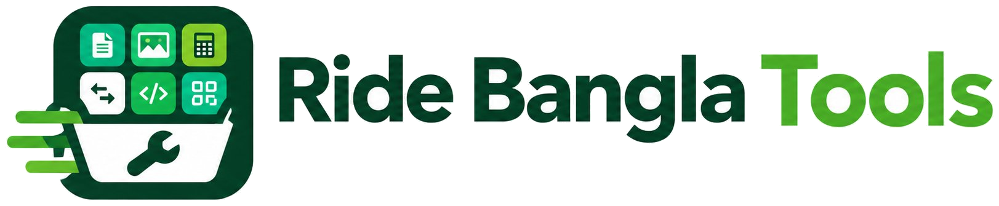
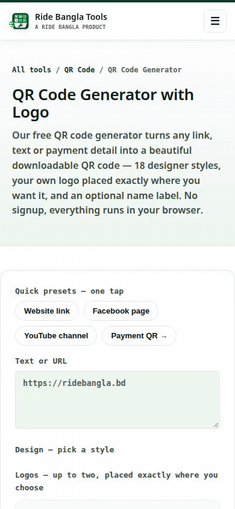
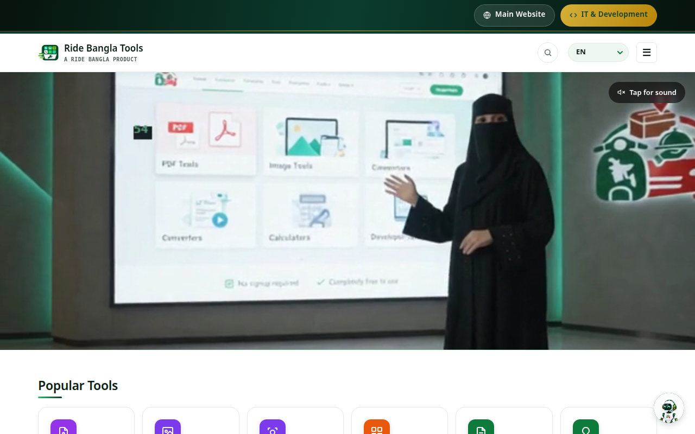
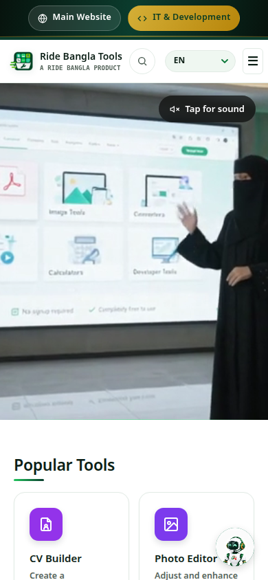
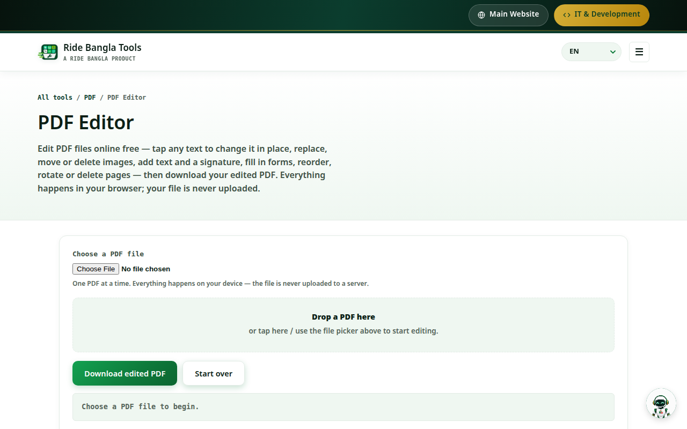
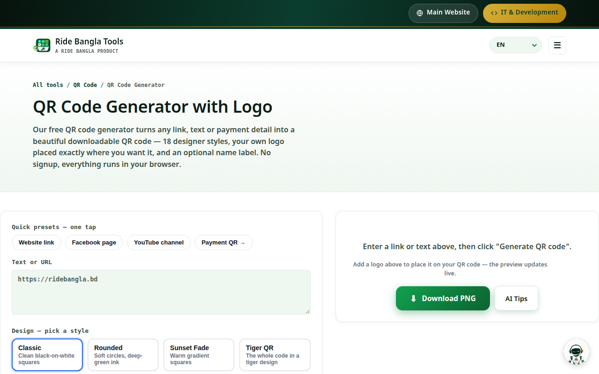
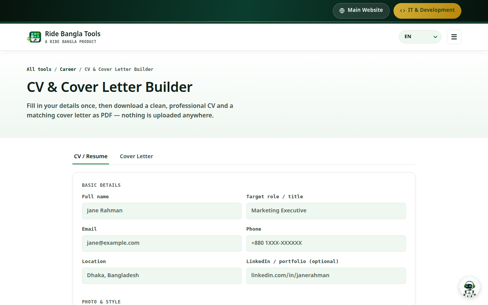
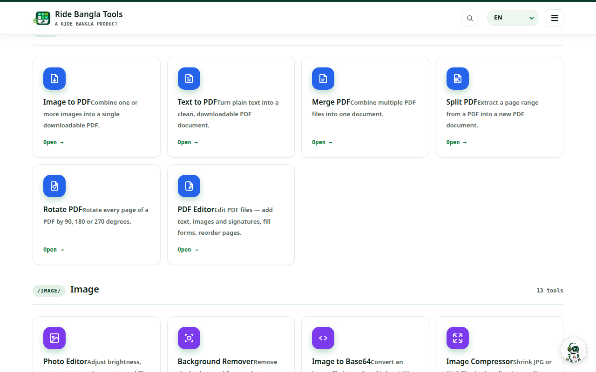

<div align="center">

<picture>
  <source media="(prefers-color-scheme: dark)" srcset="tools/assets/tools-logo-text-light.png">
  
</picture>

# Ride Bangla Tools

**67 free online tools that run in your browser — PDF, image, QR, finance, developer, text and career utilities, with no sign-up and no file uploads.**

[](https://tools.ridebangla.bd)
[](LICENSE)



Live demo — the QR Code Generator in action: a link is typed, the **Bird QR** designer style is picked, **Generate QR code** is clicked, and the finished code — the QR pattern itself forms the bird design — fills the final frames, ready to download as a PNG.



</div>

---

## About

**Ride Bangla Tools** is a product of **Ride Bangla Limited**. It is one toolbox of **67 single-purpose utilities** in 12 categories: edit, merge, split or rotate a PDF; remove an image background or strip its hidden metadata; convert an iPhone HEIC photo; build a CV and cover letter; calculate a loan EMI or zakat; generate a designer QR code; format JSON — and much more.

There is **no account system and no database**. Every tool runs with JavaScript inside the visitor's own browser, so files are never uploaded to a server. The only server-side pieces are two small Vercel functions: an AI proxy (provider keys stay server-side) and a URL-shortener proxy.

The site is styled in Tools' own design language — a deep-green (`#0B3D2E`) and vibrant-green palette with white surfaces, Space Grotesk headings and IBM Plex Mono labels — deliberately distinct from the main Ride Bangla website, while its header credits it as *“A Ride Bangla Product”*.

<div align="center">

</div>

---

## Features

### 📄 PDF Tools — 6 tools

Edit, merge, split and rotate PDFs, or create one from images or text — all locally in the browser, using PDF.js and pdf-lib.



- **PDF Editor** — tap text to change it, replace, move or delete images, add text and a signature, fill forms, reorder, rotate or delete pages, then download the edited PDF.
- **Merge PDF**, **Split PDF**, **Rotate PDF** (90° / 180° / 270°), **Image to PDF** and **Text to PDF**.

> **Honest status:** a deep rework of the PDF Editor (v4 — tap-to-edit accuracy at every zoom and pan state, and exact phone fit) is **scheduled, not yet shipped**. The editor above is the current live version; it is not presented here as perfect.

### 🖼️ Image Tools — 13 tools

Background Remover, Photo Editor, Image Compressor, Image Resizer, Image Cropper, Image Format Converter (PNG / JPG / WebP), Image to Base64, Image Watermark, Metadata Remover (strips EXIF/GPS from photos), HEIC to JPG, Favicon Generator, Color Palette Generator and YouTube Thumbnail Downloader.

### 📱 QR & Barcode Tools — 6 tools



- **QR Code Generator** — links and text in **18 designer styles** (the page's own count), with your own logo placed on the code and an optional name label.
- **Payment QR Generator** — scannable QR for bKash, Nagad, Rocket, bank or custom payment details.
- **QR Code Reader** (camera or uploaded photo), **Wi-Fi QR Generator**, **vCard QR Generator** and **Barcode Generator** (Code 128, SVG or PNG).

### 🎓 Career — CV & Cover Letter Builder



Fill in your details once — with Bangladesh location data built in — then download a clean, professional CV and a matching cover letter as PDF. Nothing is uploaded anywhere.

### 💰 Finance & Business — 11 tools

- **Finance (7):** Loan EMI Calculator, Mortgage Calculator, Compound Interest Calculator, Simple Interest Calculator, Discount Calculator, Tip Calculator, Zakat Calculator.
- **Business (4):** Invoice Generator, Quotation Generator, Business Name Generator, Freelance Rate Calculator.

### 🧮 Calculators, Converters & Date/Time — 10 tools

- **Calculator (2):** BMI Calculator, Percentage Calculator.
- **Converter (2):** Unit Converter, Number Base Converter.
- **Date & Time (6):** Age Calculator, Date Difference Calculator, Countdown Timer, Military Time Converter, Time Zone Converter, Timestamp Converter.

### ⌨️ Developer, Text & SEO — 20 tools

- **Developer (11):** JSON Formatter, Color Converter, CSS Minifier, CSV ↔ JSON Converter, JWT Decoder, Markdown to HTML, Password Generator, Regex Tester, Text Diff Checker, URL Encoder / Decoder, UUID Generator.
- **Text (6):** Word Counter, Case Converter, Lorem Ipsum Generator, Remove Duplicate Lines, Text to Speech, Base64 Encoder / Decoder.
- **SEO (3):** Meta Tag Generator, Slug Generator, URL Shortener.



### 🤖 AI assistance inside every tool

Every one of the 67 tool pages loads the shared in-tool AI helper (`tools/assets/ai.js` — verified present in 67 of 67 tool pages in this repository). It opens a styled in-panel assistant — visible as the **AI Tips** button in the QR screenshot above — and never a native alert or raw markdown. Requests go through this site's own serverless proxy (`tools/api/ai.js`), which runs a Groq → Gemini chain; provider keys stay server-side and never reach the browser. The site-wide help is the Ride Bangla AI Agent widget.

### 🔒 Private by design, multilingual, installable

- **Files stay on the device** — tools process everything client-side; there is no upload endpoint for your documents or photos.
- **16 languages** — language packs ship in `tools/assets/i18n/` (English default, plus Bengali and 14 more) for the site chrome.
- **PWA** — a web app manifest and service worker (`tools/assets/manifest.webmanifest`, `tools/sw.js`) make the toolbox installable and offline-capable.

> **Reviews note:** the site's reviews section currently shows an honest *“Reviews are temporarily unavailable”* state (its loader in `tools/assets/reviews.js` renders that message instead of a fake score when the shared backend quota is exhausted). No live reviews feed is claimed here.

---

## All 67 tools

| Category | Tools |
|---|---|
| **PDF (6)** | [PDF Editor](https://tools.ridebangla.bd/pdf/pdf-editor.html) · [Merge PDF](https://tools.ridebangla.bd/pdf/merge-pdf.html) · [Split PDF](https://tools.ridebangla.bd/pdf/split-pdf.html) · [Rotate PDF](https://tools.ridebangla.bd/pdf/rotate-pdf.html) · [Image to PDF](https://tools.ridebangla.bd/pdf/image-to-pdf.html) · [Text to PDF](https://tools.ridebangla.bd/pdf/text-to-pdf.html) |
| **Image (13)** | [Background Remover](https://tools.ridebangla.bd/image/background-remover.html) · [Photo Editor](https://tools.ridebangla.bd/image/photo-editor.html) · [Image Compressor](https://tools.ridebangla.bd/image/image-compressor.html) · [Image Resizer](https://tools.ridebangla.bd/image/image-resizer.html) · [Image Cropper](https://tools.ridebangla.bd/image/image-cropper.html) · [Format Converter](https://tools.ridebangla.bd/image/image-format-converter.html) · [Image to Base64](https://tools.ridebangla.bd/image/image-to-base64.html) · [Watermark](https://tools.ridebangla.bd/image/image-watermark.html) · [Metadata Remover](https://tools.ridebangla.bd/image/metadata-remover.html) · [HEIC to JPG](https://tools.ridebangla.bd/image/heic-to-jpg.html) · [Favicon Generator](https://tools.ridebangla.bd/image/favicon-generator.html) · [Color Palette](https://tools.ridebangla.bd/image/color-palette-generator.html) · [YouTube Thumbnail](https://tools.ridebangla.bd/image/youtube-thumbnail-downloader.html) |
| **QR (6)** | [QR Generator](https://tools.ridebangla.bd/qr/qr-code-generator.html) · [Payment QR](https://tools.ridebangla.bd/qr/payment-qr-generator.html) · [QR Reader](https://tools.ridebangla.bd/qr/qr-code-reader.html) · [Wi-Fi QR](https://tools.ridebangla.bd/qr/wifi-qr-generator.html) · [vCard QR](https://tools.ridebangla.bd/qr/vcard-qr-generator.html) · [Barcode](https://tools.ridebangla.bd/qr/barcode-generator.html) |
| **Finance (7)** | [Loan EMI](https://tools.ridebangla.bd/finance/loan-emi-calculator.html) · [Mortgage](https://tools.ridebangla.bd/finance/mortgage-calculator.html) · [Compound Interest](https://tools.ridebangla.bd/finance/compound-interest-calculator.html) · [Simple Interest](https://tools.ridebangla.bd/finance/simple-interest-calculator.html) · [Discount](https://tools.ridebangla.bd/finance/discount-calculator.html) · [Tip](https://tools.ridebangla.bd/finance/tip-calculator.html) · [Zakat](https://tools.ridebangla.bd/finance/zakat-calculator.html) |
| **Business (4)** | [Invoice](https://tools.ridebangla.bd/business/invoice-generator.html) · [Quotation](https://tools.ridebangla.bd/business/quotation-generator.html) · [Business Name](https://tools.ridebangla.bd/business/business-name-generator.html) · [Freelance Rate](https://tools.ridebangla.bd/business/freelance-rate-calculator.html) |
| **Career (1)** | [CV & Cover Letter Builder](https://tools.ridebangla.bd/career/cv-cover-letter-builder.html) |
| **Calculator (2)** | [BMI](https://tools.ridebangla.bd/calculator/bmi-calculator.html) · [Percentage](https://tools.ridebangla.bd/calculator/percentage-calculator.html) |
| **Converter (2)** | [Unit Converter](https://tools.ridebangla.bd/converter/unit-converter.html) · [Base Converter](https://tools.ridebangla.bd/converter/base-converter.html) |
| **Date & Time (6)** | [Age](https://tools.ridebangla.bd/date-time/age-calculator.html) · [Date Difference](https://tools.ridebangla.bd/date-time/date-difference-calculator.html) · [Countdown](https://tools.ridebangla.bd/date-time/countdown-timer.html) · [Military Time](https://tools.ridebangla.bd/date-time/military-time-converter.html) · [Time Zone](https://tools.ridebangla.bd/date-time/time-zone-converter.html) · [Timestamp](https://tools.ridebangla.bd/date-time/timestamp-converter.html) |
| **Developer (11)** | [JSON Formatter](https://tools.ridebangla.bd/developer/json-formatter.html) · [Color Converter](https://tools.ridebangla.bd/developer/color-converter.html) · [CSS Minifier](https://tools.ridebangla.bd/developer/css-minifier.html) · [CSV ↔ JSON](https://tools.ridebangla.bd/developer/csv-json-converter.html) · [JWT Decoder](https://tools.ridebangla.bd/developer/jwt-decoder.html) · [Markdown to HTML](https://tools.ridebangla.bd/developer/markdown-to-html.html) · [Password Generator](https://tools.ridebangla.bd/developer/password-generator.html) · [Regex Tester](https://tools.ridebangla.bd/developer/regex-tester.html) · [Text Diff](https://tools.ridebangla.bd/developer/text-diff-checker.html) · [URL Encoder](https://tools.ridebangla.bd/developer/url-encoder-decoder.html) · [UUID Generator](https://tools.ridebangla.bd/developer/uuid-generator.html) |
| **Text (6)** | [Word Counter](https://tools.ridebangla.bd/text/word-counter.html) · [Case Converter](https://tools.ridebangla.bd/text/case-converter.html) · [Lorem Ipsum](https://tools.ridebangla.bd/text/lorem-ipsum-generator.html) · [Remove Duplicate Lines](https://tools.ridebangla.bd/text/remove-duplicate-lines.html) · [Text to Speech](https://tools.ridebangla.bd/text/text-to-speech.html) · [Base64](https://tools.ridebangla.bd/text/base64-encoder-decoder.html) |
| **SEO (3)** | [Meta Tags](https://tools.ridebangla.bd/seo/meta-tag-generator.html) · [Slug Generator](https://tools.ridebangla.bd/seo/slug-generator.html) · [URL Shortener](https://tools.ridebangla.bd/seo/url-shortener.html) |

---

## How it works

1. **Open a tool** from [tools.ridebangla.bd](https://tools.ridebangla.bd) — no sign-up, no install.
2. **Work in your browser** — your file or text is processed by JavaScript on your own device (PDF.js / pdf-lib for documents, Canvas for images, in-page generators for QR codes); it is never uploaded.
3. **Download the result** — a PDF, an image, a QR PNG, or copyable text, depending on the tool.
4. **Ask the in-tool AI** when you need help — the AI Tips panel answers through the site's own proxy, with provider keys kept server-side.

```text
tools/
├── index.html            Homepage — searchable index of all 67 tools
├── pdf/  image/  qr/     Category folders: an index page + one HTML file per tool
├── calculator/  converter/  text/  seo/  developer/
├── date-time/  finance/  business/  career/
├── api/
│   ├── ai.js             Vercel function — AI proxy (Groq → Gemini)
│   └── shorten.js        Vercel function — URL-shortener proxy
└── assets/               Shared CSS/JS, the Tools logo set, i18n packs, PWA icons
```

---

## Tech stack

Only what is actually in this repository:

- **Static site** — plain HTML, CSS and JavaScript under `tools/`; no build step, no framework, no package.json.
- **Styling** — one shared stylesheet (`tools/assets/style.css`); Google Fonts: Space Grotesk, IBM Plex Mono, Noto Sans Bengali.
- **PDF** — PDF.js and pdf-lib (vendored in `tools/assets/`, with CDN copies on some pages).
- **QR & barcodes** — the site's own QR studio/design scripts (`qr-studio.js`, `qr-designs.js`), jsQR for reading, JsBarcode for barcodes.
- **Image/media libraries (lazy-loaded per tool, via CDN)** — @imgly/background-removal, heic2any, exifr, ffmpeg.wasm, html2canvas.
- **Serverless (Vercel)** — two functions only: `tools/api/ai.js` (AI proxy, Groq → Gemini chain) and `tools/api/shorten.js` (URL shortener).
- **PWA** — web app manifest + service worker; security headers are set in `tools/vercel.json` (CSP, HSTS, `nosniff`, frame and referrer policies).

---

## Security

Please report vulnerabilities privately — see **[SECURITY.md](SECURITY.md)** (report to support@ridebangla.bd; do not open a public issue for a security problem).

---

## The Ride Bangla ecosystem

Ride Bangla Tools is one part of Ride Bangla Limited:

| Service | Link |
|---|---|
| Ride Bangla — main website | [ridebangla.bd](https://ridebangla.bd) |
| AI Agent platform | [ai.ridebangla.bd](https://ai.ridebangla.bd) |
| Studio | [studio.ridebangla.bd](https://studio.ridebangla.bd) |
| **Tools (this project)** | **[tools.ridebangla.bd](https://tools.ridebangla.bd)** |
| IT Team | [it.ridebangla.bd](https://it.ridebangla.bd) |
| Customer app | [customer.ridebangla.bd](https://customer.ridebangla.bd) |
| Partner app | [partner.ridebangla.bd](https://partner.ridebangla.bd) |
| Rider app | [rider.ridebangla.bd](https://rider.ridebangla.bd) |
| Agent app | [agent.ridebangla.bd](https://agent.ridebangla.bd) |

Ride Bangla Limited is led by Enamul Seddik (Co-Founder & CEO), Emon Seddik (Co-Founder & Director) and Obayedur Rahman Shaikh (Co-Founder & Marketing Director); the IT Team is directed by Tabassum Nisha.

---

## Contact & community

- **General:** info@ridebangla.bd
- **Support / security reports:** support@ridebangla.bd
- **Help Center:** [tools.ridebangla.bd/help-center.html](https://tools.ridebangla.bd/help-center.html)

<p>
  <a href="https://www.facebook.com/ridebangla"></a>&nbsp; <a href="https://www.facebook.com/ridebangla">Facebook</a> &nbsp;·&nbsp;
  <a href="https://x.com/ridebangla"></a>&nbsp; <a href="https://x.com/ridebangla">X</a> &nbsp;·&nbsp;
  <a href="https://www.instagram.com/ride.bangla_"></a>&nbsp; <a href="https://www.instagram.com/ride.bangla_">Instagram</a> &nbsp;·&nbsp;
  <a href="https://www.threads.net/@ride.bangla_"></a>&nbsp; <a href="https://www.threads.net/@ride.bangla_">Threads</a> &nbsp;·&nbsp;
  <a href="https://www.tiktok.com/@ridebangla0"></a>&nbsp; <a href="https://www.tiktok.com/@ridebangla0">TikTok</a> &nbsp;·&nbsp;
  <a href="https://www.youtube.com/@ridebangla-0"></a>&nbsp; <a href="https://www.youtube.com/@ridebangla-0">YouTube</a>
</p>

- **Community group:** [Ride Bangla Community on Facebook](https://www.facebook.com/share/g/1CfmiTzv1D/)

---

## License

Proprietary — © 2026 Ride Bangla Limited. All rights reserved. See **[LICENSE](LICENSE)**. No part of this software may be copied, reproduced, modified or distributed without the prior written permission of Ride Bangla Limited, except where a separate written agreement expressly permits it. Third-party components remain under their own licenses.
